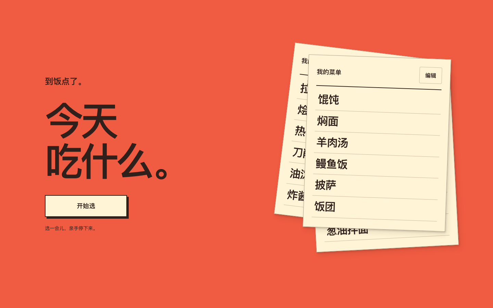

# 吃什么

到饭点了，还没想好吃什么？点一下开始，再点一下停下，把这一顿交给菜单。

[在线体验](https://chishenme-one.vercel.app) · [反馈问题](https://github.com/Liiaming/chishenme/issues) · [参与贡献](CONTRIBUTING.md)



## 能做什么

- **随机选一餐**：内置 80 道日常餐食，随时喊停，也可以再选一次。
- **用自己的菜单**：添加、删除菜名，或重置回默认菜单。
- **打开就能用**：无需注册，菜单保存在当前浏览器，多标签页同步。
- **电脑和手机都能用**：支持键盘操作，并适配系统的“减少动态效果”设置。

应用不上传菜单。清除浏览器数据，或换浏览器、域名后，自定义菜单不会自动保留或迁移。

## 本地运行

需要 Node.js 24.x 和 npm 11。

```bash
git clone https://github.com/Liiaming/chishenme.git
cd chishenme
npm ci
npm run dev
```

打开 [localhost:3000](http://localhost:3000)。无需配置环境变量或数据库。

## 自己部署

```bash
npm run build
```

将生成的 `out/` 目录部署到静态站点服务即可，生产环境请使用 HTTPS。用 `npm start` 可以在本地预览构建结果。

完整配置见 [部署说明](docs/deployment.md)。

## 开发与贡献

使用 Next.js、React、TypeScript、Tailwind CSS 和 shadcn/ui，采用纯静态导出。

- [开发指南](docs/development.md)：目录结构、实现约定与测试命令。
- [贡献指南](CONTRIBUTING.md)：反馈问题、提出建议和提交 PR。
- [安全问题](SECURITY.md)：私密报告漏洞。
- [文档目录](docs/README.md)：开发、部署与贡献说明。

## 来源与许可

项目源自 [huangyafei/chishenme](https://github.com/huangyafei/chishenme)，感谢原作者和历次贡献者。

沿用 [WTFPL 2.0](LICENSE) 协议。第三方依赖及其附带资源遵循各自的许可证。
